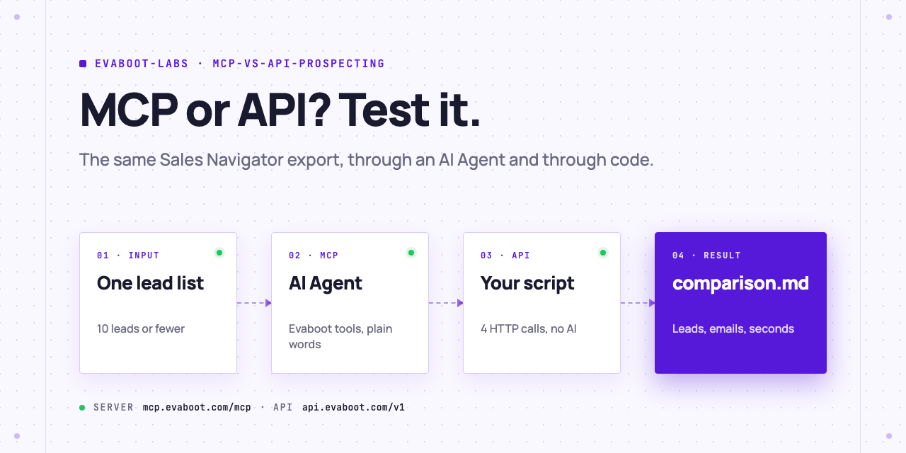
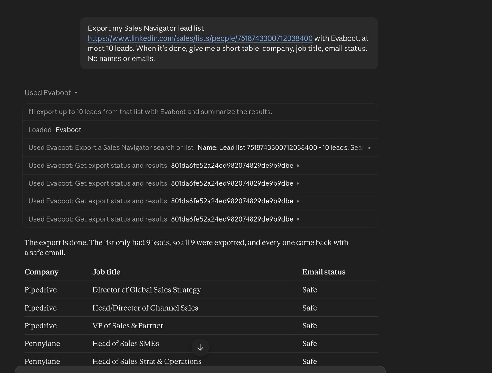
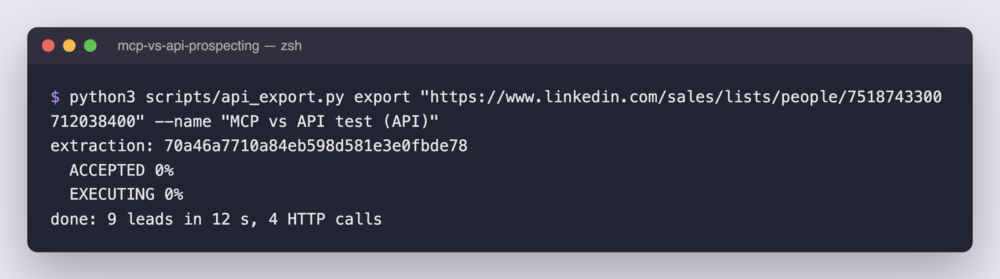
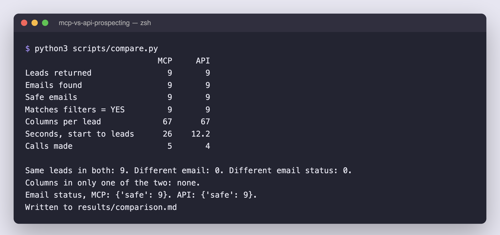

<picture>
  <source media="(prefers-color-scheme: dark)" srcset=".github/assets/banner-dark.png">
  
</picture>

# MCP vs API for prospecting

Run the same small Sales Navigator export twice: once through the Evaboot MCP server in your AI Agent, once through the Evaboot API with a script. Get one table with the leads, emails, calls and seconds of each, then pick the path that fits your team.

[](AGENTS.md)
[](https://evaboot.com/mcp)
[](LICENSE)

## Set it up in one prompt

Paste this into Claude Code, Codex or Cursor:

```text
Clone https://github.com/evaboot-labs/mcp-vs-api-prospecting, read AGENTS.md and follow the skill. Export my smallest Sales Navigator lead list through the Evaboot MCP and the Evaboot API, then compare the two.
```

<details>
<summary>Or install the skill</summary>

Claude Code:

```text
/plugin marketplace add evaboot-labs/mcp-vs-api-prospecting
/plugin install mcp-vs-api-prospecting@evaboot-labs-mcp-vs-api-prospecting
```

Codex, Cursor and other agents:

```bash
npx skills add evaboot-labs/mcp-vs-api-prospecting
```

</details>

## How it works

**1. The MCP path: one sentence.** Your AI Agent calls the Evaboot export tool with a cap, watches the status and reads the leads.



**2. The API path: one script.** [scripts/api_export.py](scripts/api_export.py) starts the extraction, polls until it is done and times every HTTP call.



**3. One table to decide.** [scripts/compare.py](scripts/compare.py) matches the two exports lead by lead and writes `results/comparison.md`.



## What you need

- An [Evaboot account](https://dash.evaboot.com/accounts/signup/?last_click_origin=mcp-vs-api-prospecting-repo) and a Sales Navigator seat.
- A Sales Navigator lead list with 10 leads or fewer: the API exports the whole list.
- Python 3 for the API script. No packages to install.
- Cost: 1 Evaboot credit per lead, per path. A 9-lead list costs 18 credits.

## Go further

| Page | For |
|---|---|
| [docs/connect-your-agent.md](docs/connect-your-agent.md) | The MCP server and the API key, by hand |
| [docs/when-to-use-which.md](docs/when-to-use-which.md) | Our results and the decision rule |
| [docs/n8n.md](docs/n8n.md) | Both paths side by side in n8n |

---

Agents: start at [AGENTS.md](AGENTS.md) · Built by [Evaboot](https://evaboot.com) · More workflows at [github.com/evaboot-labs](https://github.com/evaboot-labs) · [MIT license](LICENSE)
